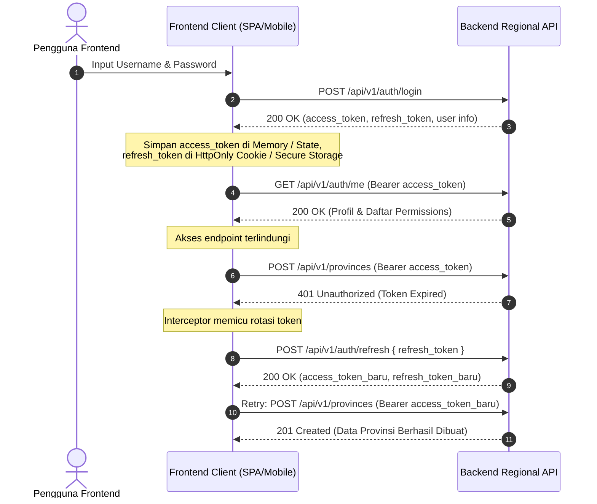

# Standalone RESTful API Reference Specification & Frontend Integration Blueprint
## Indonesian Regional Administrative Service (`be_region_indonesia`)
### Architecture Engineer Specification — Frontend & Consumer Reference

| Attribute | Detail |
| :--- | :--- |
| **API Name** | Backend Regional Indonesia RESTful Service |
| **Protocol** | HTTP/1.1 & HTTP/2 (JSON over HTTPS) |
| **Base URL (Local/Dev)** | `http://127.0.0.1:8080/api/v1` |
| **Base URL (Production)**| `https://api.domainanda.com/api/v1` |
| **Auth Scheme** | Bearer Token (Dual-Token: Short-Lived Access Token + Refresh Token Rotation) |
| **Authorization** | Dynamic PBAC (Permission-Based Access Control) & Data-Level Scoping |
| **Interactive Docs** | Swagger UI: `/swagger/index.html` (dapat diaktifkan via `SWAGGER_ENABLED=true`) |
| **Last Updated** | 2026-11-26 |

---

## 1. Arsitektur Komunikasi & Standar Global API

### 1.1 Format Response Envelope
Seluruh endpoint menggunakan format pembungkus (*response envelope*) standar yang konsisten untuk memudahkan deserialisasi di sisi Frontend:

#### A. Success Envelope (`200 OK`, `201 Created`)
```typescript
interface ApiResponse<T> {
  success: true;
  message: string;
  data: T;
  meta?: {
    page: number;
    limit: number;
    total_records: number;
    total_pages: number;
  };
}
```

#### B. Error Envelope (`400`, `401`, `403`, `404`, `409`, `422`, `429`, `500`)
```typescript
interface ApiErrorResponse {
  success: false;
  message: string;
  errors?: Array<{
    field: string;
    issue: string;
  }>;
}
```

### 1.2 Daftar Kode Status HTTP (HTTP Status Codes)

| Kode | Arti | Skenario Penggunaan |
| :--- | :--- | :--- |
| `200 OK` | Sukses | Request pembacaan, perbaruan, atau login/refresh berhasil. |
| `201 Created` | Berhasil Dibuat | Entitas wilayah baru atau token berhasil dibuat. |
| `400 Bad Request` | Permintaan Salah | Format payload JSON rusak atau parameter query tidak valid. |
| `401 Unauthorized` | Belum Terotentikasi | Header token tidak ada, token kedaluwarsa, atau kredensial login salah. |
| `403 Forbidden` | Izin Ditolak | Token valid namun tidak memiliki permission yang diminta atau di luar yurisdiksi. |
| `404 Not Found` | Tidak Ditemukan | Kode wilayah atau entitas yang diminta tidak ditemukan di database. |
| `409 Conflict` | Konflik Data | Kode wilayah sudah terdaftar, atau menghapus wilayah yang masih memiliki sub-wilayah aktif. |
| `422 Unprocessable`| Validasi Gagal | Validasi field DTO gagal (contoh: format kode pos harus tepat 5 digit numerik). |
| `429 Too Many Req` | Batas Kuota Habis | Melewati limit rate limiter (120 req/menit public, 30 req/menit auth). |
| `500 Server Error` | Kesalahan Internal | Kendala tak terduga pada server/database (hubungi tim backend). |

---

## 2. Autentikasi Dual-Token & PBAC (Frontend Guide)

Sistem menggunakan arsitektur **Dual-Token** dengan **Refresh Token Rotation (RTR)** dan **Pencabutan Otomatis (Reuse Detection)**:
- **Access Token:** JWT berumur pendek (15 menit), dikirim pada header `Authorization: Bearer <access_token>`.
- **Refresh Token:** String opaque acak (TTL 7 hari), digunakan untuk meminta Access Token baru tanpa meminta pengguna login ulang.



---

### 2.1 Endpoint Login Pengguna (`POST /api/v1/auth/login`)
Melakukan autentikasi kredensial pengguna dan mengembalikan pasangan token.
- **URL:** `/api/v1/auth/login`
- **Method:** `POST`
- **Auth:** Public (Rate limit 30 req/menit)
- **Request Headers:** `Content-Type: application/json`

#### Request Payload:
```json
{
  "username": "admin",
  "password": "AdminRegional2026!"
}
```

#### Field Validation:
| Field | Tipe | Wajib? | Keterangan |
| :--- | :--- | :--- | :--- |
| `username` | `string` | Ya | Panjang 3 - 50 karakter. |
| `password` | `string` | Ya | Panjang 6 - 100 karakter. |

#### Response `200 OK`:
```json
{
  "success": true,
  "message": "Autentikasi berhasil.",
  "data": {
    "access_token": "eyJhbGciOiJIUzI1NiIsInR5cCI6IkpXVCJ9...",
    "refresh_token": "9a1b2c3d4e5f6a7b8c9d0e1f2a3b4c5d6e7f8a9b0c1d2e3f4a5b6c7d8e9f0a1b",
    "token_type": "Bearer",
    "expires_in_seconds": 900,
    "user": {
      "id": "usr_root_superadmin",
      "username": "admin",
      "email": "admin@region.id",
      "region_scope": "*",
      "is_active": true,
      "roles": [
        {
          "id": "role_superadmin",
          "code": "SUPERADMIN",
          "name": "Super Administrator",
          "description": "Akses penuh ke seluruh modul sistem dan wilayah",
          "is_system": true
        }
      ],
      "created_at": "2026-11-26T10:11:41.336817+07:00",
      "updated_at": "2026-11-26T10:11:41.336817+07:00"
    }
  }
}
```

#### Response `401 Unauthorized`:
```json
{
  "success": false,
  "message": "Nama pengguna atau kata sandi salah.",
  "errors": [
    {
      "field": "credentials",
      "issue": "Kombinasi nama pengguna dan kata sandi tidak sesuai."
    }
  ]
}
```

---

### 2.2 Endpoint Rotasi Refresh Token (`POST /api/v1/auth/refresh`)
Memvalidasi Refresh Token lama, mencabutnya (*revocation*), dan menerbitkan token baru.
- **URL:** `/api/v1/auth/refresh`
- **Method:** `POST`
- **Auth:** Public (menggunakan body `refresh_token`)

#### Request Payload:
```json
{
  "refresh_token": "9a1b2c3d4e5f6a7b8c9d0e1f2a3b4c5d6e7f8a9b0c1d2e3f4a5b6c7d8e9f0a1b"
}
```

#### Response `200 OK`:
```json
{
  "success": true,
  "message": "Token berhasil diperbarui.",
  "data": {
    "access_token": "eyJhbGciOiJIUzI1NiIsInR5cCI6IkpXVCJ9.baru...",
    "refresh_token": "e5f6a7b8c9d0e1f2a3b4c5d6e7f8a9b0c1d2e3f4a5b6c7d8e9f0a1b9a1b2c3d4",
    "token_type": "Bearer",
    "expires_in_seconds": 900
  }
}
```

> [!WARNING]
> **Deteksi Pencurian Token (*Reuse Detection*):**
> Jika Refresh Token yang sudah pernah di-rotate dikirimkan kembali (misalnya dicuri pihak ketiga), backend akan mengembalikan status `401 Unauthorized` dan **otomatis mencabut seluruh sesi** pengguna pada rantai token tersebut. Frontend wajib mengarahkan pengguna untuk login ulang.

---

### 2.3 Endpoint Profil Pengguna & Izin Aktif (`GET /api/v1/auth/me`)
Mengambil informasi lengkap profil pengguna yang sedang login dan seluruh daftar izin (*permissions*) aktif yang dimiliki untuk acuan kontrol antarmuka Frontend.
- **URL:** `/api/v1/auth/me`
- **Method:** `GET`
- **Headers:** `Authorization: Bearer <access_token>`

#### Response `200 OK`:
```json
{
  "success": true,
  "message": "Data profil berhasil diambil.",
  "data": {
    "user": {
      "id": "usr_root_superadmin",
      "username": "admin",
      "email": "admin@region.id",
      "region_scope": "*",
      "is_active": true,
      "roles": [
        {
          "id": "role_superadmin",
          "code": "SUPERADMIN",
          "name": "Super Administrator",
          "is_system": true
        }
      ]
    },
    "permissions": [
      "regions:read",
      "regions:create",
      "regions:update",
      "regions:delete",
      "postal:update",
      "postal:import",
      "users:manage",
      "roles:manage"
    ]
  }
}
```

---

### 2.4 Endpoint Logout (`POST /api/v1/auth/logout`)
Mencabut status validitas token saat ini (*blacklist* Access Token pada Redis dan membatalkan Refresh Token).
- **URL:** `/api/v1/auth/logout`
- **Method:** `POST`
- **Headers:** `Authorization: Bearer <access_token>`

#### Request Payload (Opsional):
```json
{
  "refresh_token": "e5f6a7b8c9d0e1f2a3b4c5d6e7f8a9b0c1d2e3f4a5b6c7d8e9f0a1b9a1b2c3d4"
}
```

#### Response `200 OK`:
```json
{
  "success": true,
  "message": "Logout berhasil. Sesi telah diakhiri."
}
```

---

### 2.5 Matriks Hak Akses (PBAC) & Scoping Yurisdiksi Wilayah

Frontend dapat menggunakan daftar izin untuk menyembunyikan atau menonaktifkan tombol UI:

| Permission Code | Keterangan Izin | Endpoint yang Memerlukan |
| :--- | :--- | :--- |
| `regions:read` | Membaca hierarki dan detail wilayah | Seluruh rute `GET /api/v1/...` |
| `regions:create` | Menambah provinsi, kab/kota, kecamatan, kelurahan | `POST /provinces`, `POST .../regencies`, `districts`, `villages` |
| `regions:update` | Mengubah nama atau tipe wilayah | `PUT /regions/:code` |
| `regions:delete` | Menghapus wilayah (soft-delete) | `DELETE /regions/:code` |
| `postal:update` | Mengubah kode pos kelurahan / menautkan Level 5 | `PUT /villages/:code/postal-code`, `POST .../postal-codes` |
| `postal:import` | Mengimpor kode pos massal via CSV | CLI Command `make import-postal-code` |

#### Panduan Yurisdiksi Wilayah (*Region Scope*):
Nilai `user.region_scope` membatasi data yang dapat dimanipulasi:
- `*` : Cakupan Nasional (seluruh wilayah Indonesia).
- `32` : Tingkat Provinsi (hanya wilayah dengan awalan kode `32.*`, misal Jawa Barat).
- `32.04` : Tingkat Kabupaten/Kota (hanya wilayah dalam Kab. Bandung).
- Jika operator mencoba mengubah wilayah di luar yurisdiksi, backend akan merespons `403 Forbidden`.

---

## 3. Endpoint Publik Pembacaan Wilayah (Cascading Queries)

Seluruh endpoint `GET` bersifat publik (dapat diakses tanpa token), didukung proteksi Singleflight & Redis cache berlatensi sub-milidetik.

### 3.1 Parameter Query Standar untuk Endpoint List
Setiap endpoint yang mengembalikan daftar data mendukung parameter berikut:

| Parameter | Tipe | Default | Keterangan |
| :--- | :--- | :--- | :--- |
| `page` | `integer` | `1` | Nomor halaman data. |
| `limit` | `integer` | `20` | Jumlah baris data per halaman (maks: 100). |
| `search` | `string` | `""` | Filter pencarian nama wilayah (pencarian teks fleksibel). |
| `order` | `string` | `code:asc` | Format `<kolom>:<arah>`. Nilai yang diizinkan: `code:asc`, `code:desc`, `name:asc`, `name:desc`. |

---

### 3.2 Daftar Provinsi (Level 1)
- **URL:** `GET /api/v1/provinces`
- **Example Request:**
  ```http
  GET /api/v1/provinces?search=jawa&page=1&limit=5&order=name:asc HTTP/1.1
  Host: 127.0.0.1:8080
  ```
- **Response `200 OK`:**
```json
{
  "success": true,
  "message": "Data provinsi berhasil diambil.",
  "data": [
    {
      "id": 32,
      "code": "32",
      "name": "JAWA BARAT",
      "level": 1,
      "type": "PROVINSI"
    },
    {
      "id": 33,
      "code": "33",
      "name": "JAWA TENGAH",
      "level": 1,
      "type": "PROVINSI"
    },
    {
      "id": 35,
      "code": "35",
      "name": "JAWA TIMUR",
      "level": 1,
      "type": "PROVINSI"
    }
  ],
  "meta": {
    "page": 1,
    "limit": 5,
    "total_records": 3,
    "total_pages": 1
  }
}
```

---

### 3.3 Detail Satu Provinsi
- **URL:** `GET /api/v1/provinces/:code`
- **Path Param:** `:code` (Kode Provinsi 2 digit, contoh: `32`)
- **Response `200 OK`:**
```json
{
  "success": true,
  "message": "Data detail wilayah berhasil diambil.",
  "data": {
    "id": 32,
    "code": "32",
    "name": "JAWA BARAT",
    "level": 1,
    "type": "PROVINSI",
    "postal_code": null,
    "created_at": "2026-11-26T10:17:35+07:00",
    "updated_at": "2026-11-26T10:17:35+07:00"
  }
}
```

---

### 3.4 Daftar Kabupaten/Kota Berdasarkan Provinsi (Level 2)
- **URL:** `GET /api/v1/provinces/:code/regencies`
- **Path Param:** `:code` (Kode Provinsi Induk, contoh: `32`)
- **Query Params:** `search`, `page`, `limit`, `order`
- **Response `200 OK`:**
```json
{
  "success": true,
  "message": "Data kabupaten/kota berhasil diambil.",
  "data": [
    {
      "id": 3201,
      "code": "32.01",
      "name": "KABUPATEN BOGOR",
      "level": 2,
      "type": "KABUPATEN"
    },
    {
      "id": 3204,
      "code": "32.04",
      "name": "KABUPATEN BANDUNG",
      "level": 2,
      "type": "KABUPATEN"
    },
    {
      "id": 3273,
      "code": "32.73",
      "name": "KOTA BANDUNG",
      "level": 2,
      "type": "KOTA"
    }
  ],
  "meta": {
    "page": 1,
    "limit": 20,
    "total_records": 27,
    "total_pages": 2
  }
}
```

---

### 3.5 Detail Satu Kabupaten/Kota
- **URL:** `GET /api/v1/regencies/:code`
- **Path Param:** `:code` (Kode Kab/Kota, contoh: `32.04`)

---

### 3.6 Daftar Kecamatan Berdasarkan Kabupaten/Kota (Level 3)
- **URL:** `GET /api/v1/regencies/:code/districts`
- **Path Param:** `:code` (Kode Kab/Kota Induk, contoh: `32.04`)
- **Query Params:** `search`, `page`, `limit`, `order`
- **Response `200 OK`:**
```json
{
  "success": true,
  "message": "Data kecamatan berhasil diambil.",
  "data": [
    {
      "id": 320405,
      "code": "32.04.05",
      "name": "SOREANG",
      "level": 3,
      "type": "KECAMATAN"
    }
  ],
  "meta": {
    "page": 1,
    "limit": 20,
    "total_records": 31,
    "total_pages": 2
  }
}
```

---

### 3.7 Detail Satu Kecamatan
- **URL:** `GET /api/v1/districts/:code`
- **Path Param:** `:code` (Kode Kecamatan, contoh: `32.04.05`)

---

### 3.8 Daftar Kelurahan/Desa Berdasarkan Kecamatan (Level 4)
- **URL:** `GET /api/v1/districts/:code/villages`
- **Path Param:** `:code` (Kode Kecamatan Induk, contoh: `32.04.05`)
- **Query Params:** `search`, `page`, `limit`, `order`
- **Response `200 OK`:**
```json
{
  "success": true,
  "message": "Data kelurahan/desa berhasil diambil.",
  "data": [
    {
      "id": 3204052001,
      "code": "32.04.05.2001",
      "name": "PAMEUNTASAN",
      "level": 4,
      "type": "DESA",
      "postal_code": "40911"
    }
  ],
  "meta": {
    "page": 1,
    "limit": 20,
    "total_records": 10,
    "total_pages": 1
  }
}
```

---

### 3.9 Detail Satu Kelurahan/Desa
- **URL:** `GET /api/v1/villages/:code`
- **Path Param:** `:code` (Kode Kelurahan/Desa, contoh: `32.04.05.2001`)

---

### 3.10 Kode Pos Spesifik Berdasarkan Kode Kelurahan/Desa
Mengambil kode pos yang ditautkan langsung pada atribut kolom kelurahan/desa.
- **URL:** `GET /api/v1/villages/:code/postal-code`
- **Path Param:** `:code` (Kode Kelurahan/Desa, contoh: `32.04.05.2001`)
- **Response `200 OK`:**
```json
{
  "success": true,
  "message": "Kode pos kelurahan berhasil ditemukan.",
  "data": {
    "village_code": "32.04.05.2001",
    "village_name": "PAMEUNTASAN",
    "postal_code": "40911"
  }
}
```

---

### 3.11 Daftar Kode Pos Kelurahan (Level 5)
Mengambil entitas anak Level 5 kode pos di bawah kelurahan.
- **URL:** `GET /api/v1/villages/:code/postal-codes`
- **Path Param:** `:code` (Kode Kelurahan/Desa, contoh: `32.04.05.2001`)

---

### 3.12 Reverse Lookup: Hierarki Lengkap Berdasarkan Kode Pos 5 Digit
Mencari hierarki lengkap (Provinsi, Kabupaten, Kecamatan, Desa) cukup dengan memasukkan 5 digit kode pos.
- **URL:** `GET /api/v1/postal-codes/:postal_code`
- **Path Param:** `:postal_code` (Nilai 5 digit angka, contoh: `40911`)
- **Response `200 OK`:**
```json
{
  "success": true,
  "message": "Hierarki wilayah berdasarkan kode pos berhasil diambil.",
  "data": {
    "postal_code": "40911",
    "village": {
      "code": "32.04.05.2001",
      "name": "PAMEUNTASAN",
      "type": "DESA"
    },
    "district": {
      "code": "32.04.05",
      "name": "SOREANG"
    },
    "regency": {
      "code": "32.04",
      "name": "KABUPATEN BANDUNG",
      "type": "KABUPATEN"
    },
    "province": {
      "code": "32",
      "name": "JAWA BARAT"
    }
  }
}
```

---

## 4. Endpoint Mutasi Terlindungi (Protected Write Mutations)

Seluruh endpoint pada bagian ini mewajibkan header:
```http
Authorization: Bearer <access_token>
Content-Type: application/json
```

---

### 4.1 Tambah Provinsi Baru (Level 1)
- **URL:** `POST /api/v1/provinces`
- **Permission Required:** `regions:create`
- **Request Body:**
```json
{
  "code": "99",
  "name": "PROVINSI BARU",
  "type": "PROVINSI"
}
```
- **Response `201 Created`:**
```json
{
  "success": true,
  "message": "Provinsi baru berhasil ditambahkan.",
  "data": {
    "id": 99,
    "code": "99",
    "name": "PROVINSI BARU",
    "level": 1,
    "type": "PROVINSI",
    "created_at": "2026-11-26T10:30:00+07:00",
    "updated_at": "2026-11-26T10:30:00+07:00"
  }
}
```

---

### 4.2 Tambah Kabupaten/Kota Baru (Level 2)
- **URL:** `POST /api/v1/provinces/:code/regencies`
- **Permission Required:** `regions:create`
- **Path Param:** `:code` (Kode Provinsi Induk, contoh: `99`)
- **Aturan Validasi:** Field `code` **wajib** memiliki awalan `:code.` (contoh: `99.01`).
- **Request Body:**
```json
{
  "code": "99.01",
  "name": "KABUPATEN NUSANTARA",
  "type": "KABUPATEN"
}
```
- **Response `201 Created`:**
```json
{
  "success": true,
  "message": "Kabupaten/kota baru berhasil ditambahkan.",
  "data": {
    "code": "99.01",
    "name": "KABUPATEN NUSANTARA",
    "level": 2,
    "type": "KABUPATEN"
  }
}
```

---

### 4.3 Tambah Kecamatan Baru (Level 3)
- **URL:** `POST /api/v1/regencies/:code/districts`
- **Permission Required:** `regions:create`
- **Path Param:** `:code` (Kode Kab/Kota Induk, contoh: `99.01`)
- **Aturan Validasi:** Field `code` **wajib** memiliki awalan `:code.` (contoh: `99.01.01`).
- **Request Body:**
```json
{
  "code": "99.01.01",
  "name": "KECAMATAN SENTOSA",
  "type": "KECAMATAN"
}
```
- **Response `201 Created`**

---

### 4.4 Tambah Kelurahan/Desa Baru (Level 4)
- **URL:** `POST /api/v1/districts/:code/villages`
- **Permission Required:** `regions:create`
- **Path Param:** `:code` (Kode Kecamatan Induk, contoh: `99.01.01`)
- **Aturan Validasi:** Field `code` **wajib** memiliki awalan `:code.` (contoh: `99.01.01.2001`).
- **Request Body:**
```json
{
  "code": "99.01.01.2001",
  "name": "DESA MAKMUR",
  "type": "DESA"
}
```
- **Response `201 Created`**

---

### 4.5 Perbarui Kode Pos Kelurahan/Desa (Field Level 4)
Memperbarui atribut kolom `postal_code` langsung pada tabel wilayah kelurahan.
- **URL:** `PUT /api/v1/villages/:code/postal-code`
- **Permission Required:** `postal:update`
- **Path Param:** `:code` (Kode Kelurahan/Desa 10 digit, contoh: `32.04.05.2001`)
- **Request Body:**
```json
{
  "postal_code": "40912"
}
```
- **Field Validation:** `postal_code` wajib 5 digit angka numerik.
- **Response `200 OK`:**
```json
{
  "success": true,
  "message": "Kode pos kelurahan berhasil diperbarui."
}
```

---

### 4.6 Perbarui Nama & Tipe Wilayah
Memperbarui atribut nama atau tipe wilayah untuk kode tertentu.
- **URL:** `PUT /api/v1/regions/:code`
- **Permission Required:** `regions:update`
- **Path Param:** `:code` (Kode wilayah yang akan diubah, contoh: `32.04`)
- **Request Body:**
```json
{
  "name": "KABUPATEN BANDUNG MAJU",
  "type": "KABUPATEN"
}
```
- **Response `200 OK`:**
```json
{
  "success": true,
  "message": "Data wilayah berhasil diperbarui.",
  "data": {
    "code": "32.04",
    "name": "KABUPATEN BANDUNG MAJU",
    "level": 2,
    "type": "KABUPATEN"
  }
}
```

---

### 4.7 Hapus Wilayah (Soft Delete dengan Proteksi Sub-Wilayah)
Menandai wilayah sebagai terhapus (*soft delete*).
- **URL:** `DELETE /api/v1/regions/:code`
- **Permission Required:** `regions:delete`
- **Path Param:** `:code` (Kode wilayah yang akan dihapus)
- **Response `200 OK` (Jika Bersih Tanpa Child):**
```json
{
  "success": true,
  "message": "Data wilayah berhasil dihapus (soft delete)."
}
```
- **Response `409 Conflict` (Jika Masih Memiliki Sub-Wilayah Aktif):**
```json
{
  "success": false,
  "message": "Terjadi konflik pada data wilayah.",
  "errors": [
    {
      "field": "children",
      "issue": "wilayah tidak dapat dihapus karena masih memiliki sub-wilayah aktif di bawahnya"
    }
  ]
}
```

---

## 5. Frontend Client Boilerplate & Interceptor Pattern

Berikut adalah contoh implementasi TypeScript & Axios client yang siap digunakan oleh tim Frontend untuk menangani rotasi token otomatis (*silent refresh*) dan antrean request (*concurrency queue*):

```typescript
import axios, { AxiosError, InternalAxiosRequestConfig } from 'axios';

// 1. Buat Axios Instance
export const apiClient = axios.create({
  baseURL: process.env.NEXT_PUBLIC_API_URL || 'http://127.0.0.1:8080/api/v1',
  headers: {
    'Content-Type': 'application/json',
  },
  timeout: 15000,
});

// State penyimpan token di memori
let currentAccessToken: string | null = null;
let currentRefreshToken: string | null = null;

export const setAuthTokens = (access: string, refresh: string) => {
  currentAccessToken = access;
  currentRefreshToken = refresh;
  if (typeof window !== 'undefined') {
    localStorage.setItem('refresh_token', refresh);
  }
};

export const clearAuthTokens = () => {
  currentAccessToken = null;
  currentRefreshToken = null;
  if (typeof window !== 'undefined') {
    localStorage.removeItem('refresh_token');
    window.location.href = '/login';
  }
};

// 2. Request Interceptor: Menyuntikkan Bearer Token
apiClient.interceptors.request.use((config: InternalAxiosRequestConfig) => {
  if (currentAccessToken && config.headers) {
    config.headers.Authorization = `Bearer ${currentAccessToken}`;
  }
  return config;
});

// 3. Response Interceptor: Penanganan 401 dan Rotasi Otomatis (RTR)
let isRefreshing = false;
let failedQueue: Array<{
  resolve: (token: string) => void;
  reject: (error: any) => void;
}> = [];

const processQueue = (error: any, token: string | null = null) => {
  failedQueue.forEach((promise) => {
    if (token) {
      promise.resolve(token);
    } else {
      promise.reject(error);
    }
  });
  failedQueue = [];
};

apiClient.interceptors.response.use(
  (response) => response,
  async (error: AxiosError) => {
    const originalRequest = error.config as InternalAxiosRequestConfig & { _retry?: boolean };

    // Jika terjadi 401 dan bukan endpoint auth/login atau auth/refresh
    if (
      error.response?.status === 401 &&
      originalRequest &&
      !originalRequest._retry &&
      !originalRequest.url?.includes('/auth/')
    ) {
      if (isRefreshing) {
        return new Promise((resolve, reject) => {
          failedQueue.push({ resolve, reject });
        })
          .then((token) => {
            originalRequest.headers.Authorization = `Bearer ${token}`;
            return apiClient(originalRequest);
          })
          .catch((err) => Promise.reject(err));
      }

      originalRequest._retry = true;
      isRefreshing = true;

      const storedRefreshToken = currentRefreshToken || (typeof window !== 'undefined' ? localStorage.getItem('refresh_token') : null);

      if (!storedRefreshToken) {
        clearAuthTokens();
        return Promise.reject(error);
      }

      try {
        const { data } = await axios.post(`${apiClient.defaults.baseURL}/auth/refresh`, {
          refresh_token: storedRefreshToken,
        });

        const newAccessToken = data.data.access_token;
        const newRefreshToken = data.data.refresh_token;

        setAuthTokens(newAccessToken, newRefreshToken);
        processQueue(null, newAccessToken);

        originalRequest.headers.Authorization = `Bearer ${newAccessToken}`;
        return apiClient(originalRequest);
      } catch (refreshErr) {
        processQueue(refreshErr, null);
        clearAuthTokens(); // Token reuse detection atau refresh token kedaluwarsa
        return Promise.reject(refreshErr);
      } finally {
        isRefreshing = false;
      }
    }

    return Promise.reject(error);
  }
);
```

---

## 6. Helper Pemeriksaan Izin (Frontend RBAC/PBAC Guard)

```typescript
// Helper untuk mengecek apakah user memiliki izin untuk menampilkan tombol aksi
export const hasPermission = (userPermissions: string[], required: string): boolean => {
  if (!userPermissions) return false;
  return userPermissions.includes(required) || userPermissions.includes('*:*');
};

// Helper untuk mengecek apakah kode wilayah target masuk ke dalam cakupan wilayah user
export const isInJurisdiction = (userScope: string, targetRegionCode: string): boolean => {
  if (!userScope || userScope === '*') return true; // Superadmin / Akses Nasional
  if (targetRegionCode === userScope) return true;
  return targetRegionCode.startsWith(userScope + '.');
};

// Contoh Penggunaan di Komponen React:
// {hasPermission(currentUser.permissions, 'postal:update') && isInJurisdiction(currentUser.region_scope, village.code) && (
//    <Button onClick={() => openEditPostalModal(village)}>Ubah Kode Pos</Button>
// )}
```

---

## 7. Status Endpoint Health & Diagnostik

| Endpoint | Method | Keterangan | Respon Normal |
| :--- | :--- | :--- | :--- |
| `/healthz` | `GET` | Liveness probe (memeriksa web server berjalan) | `{"status":"ok"}` (`200 OK`) |
| `/readyz` | `GET` | Readiness probe (memeriksa konektivitas PostgreSQL & Redis) | `{"status":"ready","database":"connected","redis":"connected"}` (`200 OK`) |
| `/swagger/index.html` | `GET` | Antarmuka interaktif OpenAPI / Swagger UI | HTML Swagger UI |
